<div align="center">

<h1>MCP Everything</h1>

<p><strong>Connect your AI agent to any website, in a few clicks.</strong><br/>
No API, no adapter, no code per site. Use the site once while the extension records, and your agent gets the tools.</p>


[](pyproject.toml)
[](https://modelcontextprotocol.io)
[](docker-compose.yml)

[](LICENSE)

[Get started](#get-started) · [Run your own server](#run-your-own-server) · [How it works](#how-it-works) · [Security](#security) · [Docs](#documentation)

</div>

<p align="center">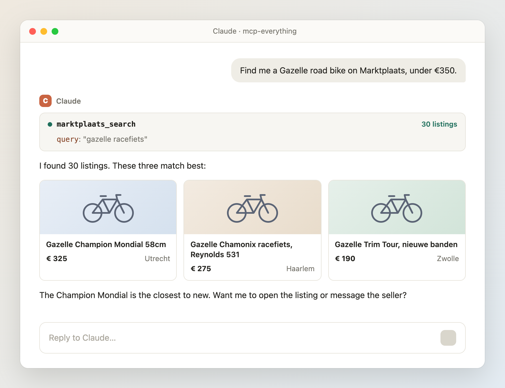</p>

Most websites have no API, and protocols like MCP only help once a site joins in. MCP Everything does not wait for the
site: it works on any website you can use in Chrome. You record a task once, and everyone on your server gets it as a
tool in Claude. Each person's logins stay their own, encrypted.

> [!NOTE]
> **Alpha.** Tested on real sites, but expect rough edges: a recording can miss a tool, a site can change, and some
> sites refuse the server. It never gets around a block. Read a site's terms before you automate it.

## Get started

You need Chrome and an invite from the admin of a server. Want your own server? See [Run your own server](#run-your-own-server).

| Step | What you do | How often |
| --- | --- | --- |
| [1. Connect Claude](#1-connect-claude) | Add `https://<server>/mcp` as a connector in Claude. On the login page that opens, create your account with your invite | Once per Claude app |
| [2. Install the extension](#2-install-the-extension) | Download it from the welcome page and load it in Chrome. It connects to your account by itself | Once per computer |
| [3. Record a site](#3-record-a-site) | Open the site, click **Start recording**, do the task once, click **Stop and make tools** | Once per site. After that, everyone on the server has the tools |
| [4. Link your account on that site](#4-link-your-account-on-that-site) | Click **Link session** in the extension, or log in on the one-time page Claude gives you | Once per site, for each person |
| [5. Ask Claude](#5-ask-claude) | Ask in plain words, like "Find me a Gazelle road bike on Marktplaats" | Whenever you like |

### 1. Connect Claude

In claude.ai or Claude Desktop: **Settings → Connectors → Add custom connector**, with `https://<server>/mcp`.
In Claude Code:

```bash
claude mcp add --transport http mcp-everything https://<server>/mcp
```

Then type `/mcp` and choose **Authenticate**. Claude opens your server's login page. New here? Paste your invite and
pick a name and a password.

<table><tr>
<td align="center" valign="top" width="50%">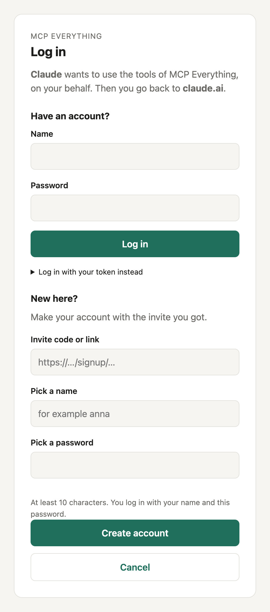<br><sub>First time: log in, or create your account with your invite</sub></td>
<td align="center" valign="top" width="50%">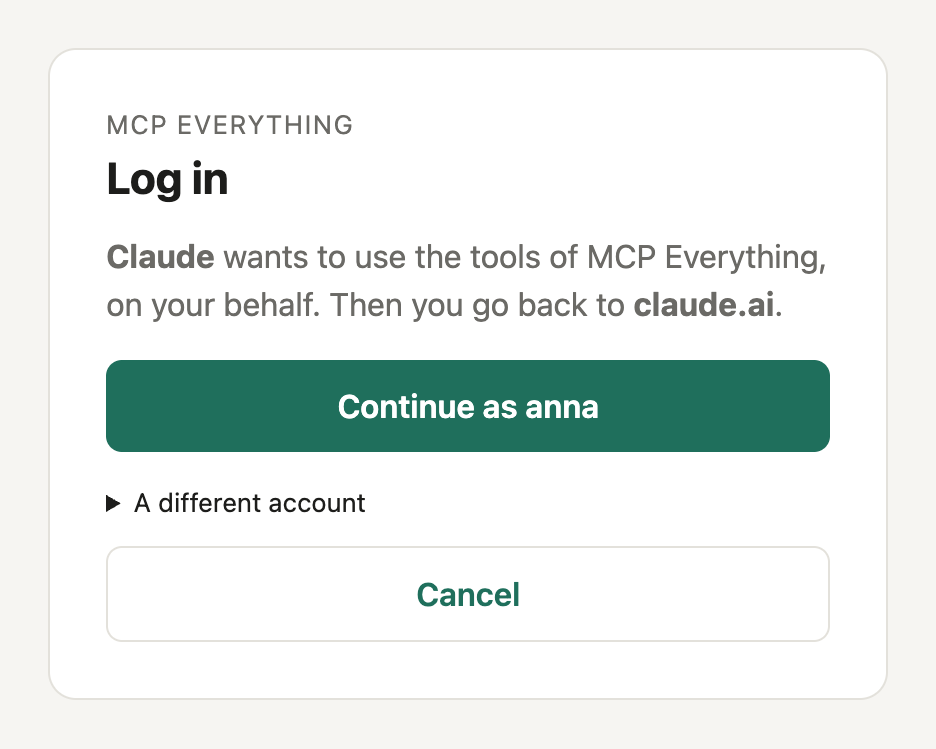<br><sub>After that: one click</sub></td>
</tr></table>

### 2. Install the extension

The welcome page offers the download. Unzip it, open `chrome://extensions`, turn on **Developer mode**, click
**Load unpacked** and choose the folder `mcp-everything-extension`. The page connects it to your account by itself.

<p align="center">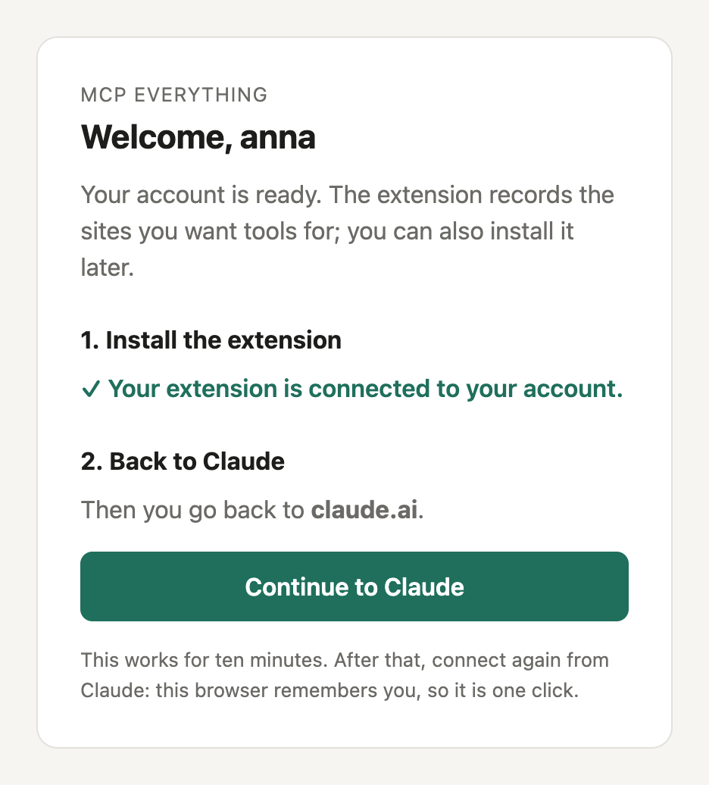<br><sub>The welcome page connects the extension. Then you go back to Claude</sub></p>

### 3. Record a site

Open the site, log in if it has a login, and click **Start recording** in the extension. The first time, Chrome asks
for access to the site. Do the task once, then click **Stop and make tools**. That takes about a minute; you can close
the popup meanwhile.

<table><tr>
<td align="center" valign="top">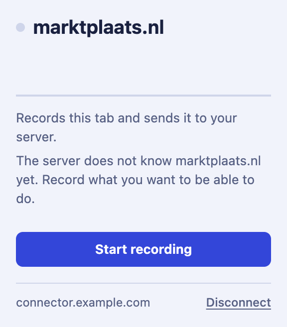<br><sub>1. Start recording</sub></td>
<td align="center" valign="top">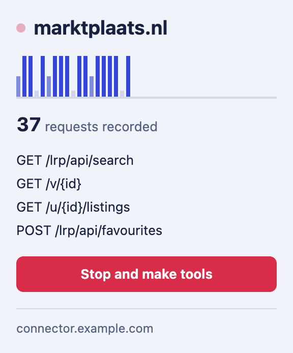<br><sub>2. Do the task once</sub></td>
<td align="center" valign="top">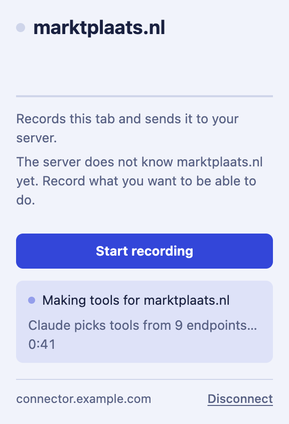<br><sub>3. The server makes tools</sub></td>
<td align="center" valign="top">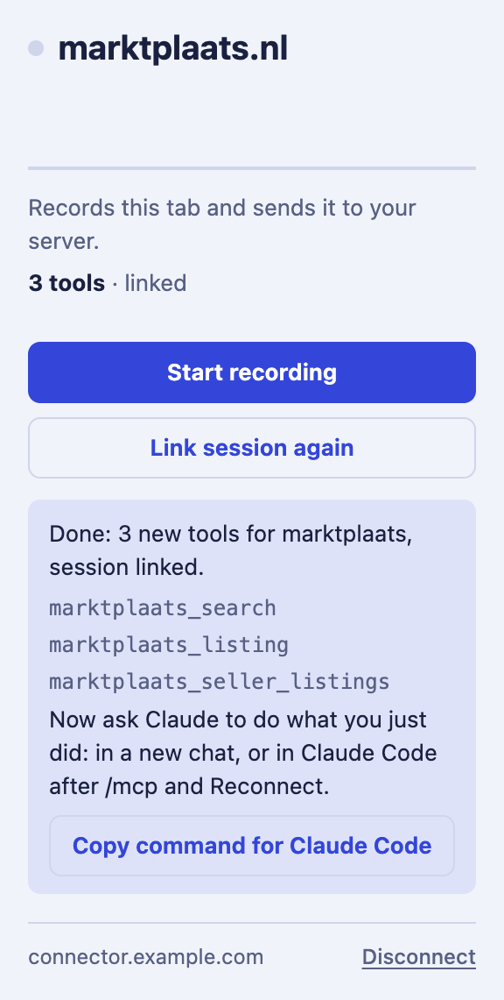<br><sub>4. Your new tools</sub></td>
</tr></table>

### 4. Link your account on that site

Tools are shared, logins are not. For a site with cookies, click **Link session** in the extension (a recording does
this for you). For a site with a password or its own OAuth, ask Claude to `connect`: you get a one-time page on your
server, and your password never goes through the chat.

<table><tr>
<td align="center" valign="top" width="50%">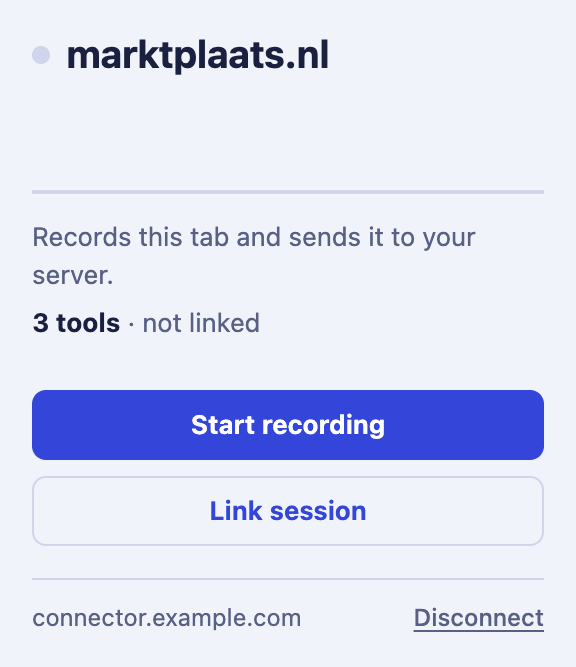<br><sub>Cookies: <b>Link session</b> in the extension</sub></td>
<td align="center" valign="top" width="50%">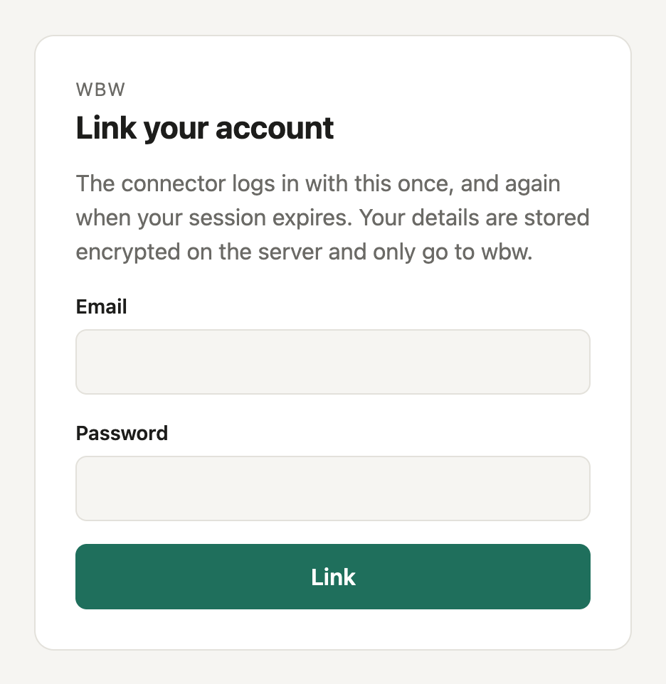<br><sub>Password: a one-time page on your server</sub></td>
</tr></table>

### 5. Ask Claude

Ask in plain words. A tool that changes something runs once, even if Claude retries. A tool that can't be undone, like
placing a bid, asks you first, with the exact values it will send. New tools show up in a new chat, or after `/mcp` →
**Reconnect** in Claude Code.

All the details, like other ways to log in and how to log out, are in [docs/using.md](docs/using.md).

## Run your own server

You need Docker and an [Anthropic API key](https://console.anthropic.com).

```bash
cp .env.example .env
openssl rand -base64 32    # paste as CONNECTOR_SECRET_KEY in .env, and add your ANTHROPIC_API_KEY
docker compose up -d --build
docker compose exec connector python -m connector.users invite --uses 3
```

Keep a copy of `CONNECTOR_SECRET_KEY`: without it, the vault does not open. For claude.ai, put the server behind a
reverse proxy with TLS and set `PUBLIC_URL`. Configuration, limits and the review of tools from guests are in
[docs/server.md](docs/server.md).

## How it works

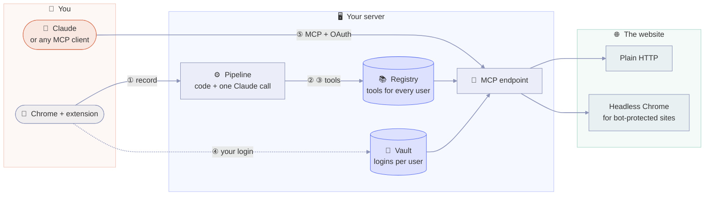

| Step | Done by |
| --- | --- |
| Group requests into endpoints; ignore pages, static files and other domains | Code |
| Take the session out of the recording; hide secrets and personal values | Code |
| Choose the endpoints worth a tool, name them, point out which values are inputs | **Claude**, one structured call |
| Rebuild each request from the recording; reject what the model invented | Code |
| Decide read or write; require a human for writes that can't be undone | Code |
| Validate the tool before it is stored and before it runs | Code |

The model never sees a cookie or a password, and never writes a request. Running a tool uses no model at all.

A tool is data, not code: a JSON manifest with the request, its inputs and how to read the answer. It runs as a plain HTTP request, or as a `fetch` in a headless Chrome for sites with
bot protection.

## Security

- **Secrets never reach the model or the shared tools.** Your sessions go to your own vault, encrypted with AES-256-GCM.
- **You type passwords on your own server**, through a one-time link. Never in the chat.
- **Claude logs in with OAuth 2.1.** Tokens are stored hashed, and refresh tokens are replaced on every use.
- **You confirm what can't be undone**, bound to the exact values shown.
- **Every request goes to the site itself**, over HTTPS. No captcha solving and no getting around a block.
- **Invite only**, with limits per person, and an optional review of tools from guests.

## FAQ

**Does Claude ever see my password?** No. You type it on a page of your own server, and it only goes to that site.

**Can other users see my sessions?** No. Tools are shared, sessions are not: a tool always runs with the session of
the person who calls it.

**How many LLM calls does it take?** One per recording, to choose and name the tools. Calling a tool uses no model.

**Is this a scraper?** No. It replays the requests a site's own frontend made, on your own account, one call at a
time. It does not crawl, and it stops when a site blocks it.

More questions in [docs/faq.md](docs/faq.md).

## Documentation

| Document | What |
| --- | --- |
| [docs/using.md](docs/using.md) | Using a server: logging in, recording, linking, logging out |
| [docs/server.md](docs/server.md) | Running a server: configuration, limits, reviewing tools from guests |
| [docs/faq.md](docs/faq.md) | Questions and answers |
| [extension/README.md](extension/README.md) | The extension, inside and out (Dutch) |

## License

Proprietary. All rights reserved; see [LICENSE](LICENSE).

---

<div align="center">

**Built for agents. Polite to websites.**

[Get started](#get-started) · [Run your own server](#run-your-own-server)

</div>
