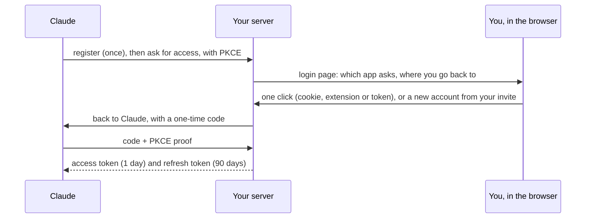

# Using MCP Everything

The full guide for people with an account on a server. The short version is in the [README](../README.md#get-started).
Running a server yourself? See [server.md](server.md).

## 1. Connect Claude

You need Chrome on a computer, and an invite from the admin: a code, or a link like `https://<server>/signup/<code>`.
Claude logs in to your server with OAuth. You never paste a token into Claude.

- **claude.ai and Claude Desktop:** in **Settings → Connectors**, add a custom connector with the address
  `https://<server>/mcp`. Claude then opens the server's login page.
- **Claude Code:** run the command below, type `/mcp`, choose the server and choose **Authenticate**. Your browser
  opens the server's login page.

```bash
claude mcp add --transport http mcp-everything https://<server>/mcp
```

The login page says which app asks for access and where you go back to after. Check both.

### New here?

Paste your invite (the code or the whole link), pick a name (2 to 32 characters: lowercase letters, digits, `.` `_`
`-`) and a password (at least 10 characters), and click **Create account**. The page becomes a welcome step: install
the extension ([step 2](#2-install-the-extension)), then click **Continue to `<app>`**. You go back to Claude, logged
in, and this browser remembers you.

The login request works for ten minutes. If it runs out while you install the extension, your account is still there:
connect again from Claude, and the login page shows **Continue as `<name>`**.

An invite works a set number of times, and the server has a maximum number of accounts. When either runs out, the
page says so.

### Already have an account?

| The page shows | When | What it does |
| --- | --- | --- |
| **Continue as `<name>`** | This browser signed up or logged in here in the last 30 days | One click |
| **Log in with the extension** | The extension is connected to this server | The extension gives the page your token; one click |
| **Name** and **Password** | Neither of the above | At most 5 wrong passwords per name per 10 minutes |

Your `usc_…` token works too, under **Log in with your token instead**. Then a step offers the extension and connects
it with that token, before you go back. **Cancel** sends you back to the app without access.

### Other ways in

- **The invite link.** Open it in Chrome. The page offers the extension and shows ✓ once it is installed. Pick a name
  and a password, and the welcome page connects the extension and shows how to connect Claude. The login in Claude is
  then one click.
- **An account from the admin.** The admin runs `python -m connector.users add <name>` and gives you the token
  (`usc_…`), once. Paste it in the extension's popup and click **Connect**. For the login page, the admin sets a
  password with `python -m connector.users password <name>`; the same command resets a forgotten one, and logs
  that user out everywhere.
- **A client without OAuth** sends the API token itself: `--header "Authorization: Bearer usc_…"`.

### How the login works



Claude renews its access by itself. Each refresh token works once and is replaced by a new one. If Claude does not
use the server for 90 days, you log in again.

### Logging out

Remove the connector in Claude. A client that logs out properly revokes its token, and the server deletes that login.
To end every login at once (for example when a token leaked), the admin gives you a new token with
`python -m connector.users add <name>`. That ends all Claude logins and the remembered browser login. Connect the
extension again with the new token.

## 2. Install the extension

The welcome step offers `/extension.zip`, with your server's address already in it. Unzip it, open
`chrome://extensions`, turn on **Developer mode**, click **Load unpacked** and choose the folder
`mcp-everything-extension`.

You do not refresh the page: it asks the extension every 2 seconds, so you can install it before or after you make the
account. As soon as the extension answers, the page gives it your API token and shows ✓. Without the extension, the
welcome step shows the token once, to paste in the popup later (**Connect**).

No extension yet, or lost it? Ask Claude: it knows where your server offers it.

## 3. Record a site

A site needs to be recorded only once: the tools are for every user on the server.

1. **Open the site** in Chrome and log in, if the site has a login. Click the extension's icon.
2. **Click Start recording.** The first time on a site, Chrome asks permission for that domain. Click **Allow**: the
   tab reloads and the recording starts. The extension only reads a site while a recording runs.
3. **Do what your agent should be able to do.** The icon shows `REC`. Passwords are masked.
4. **Click the icon, then Stop and make tools.**

The extension shows each step with the time it took. You can close the popup; it keeps going. The icon shows `…` while
it works, `✓` when it is done and `!` when it failed. Then the popup lists the new tools. If the site logs in with
cookies, your session from the recording is linked too.

On the server, code groups the requests into endpoints and removes secrets, one Claude call picks and names the
tools, and code rebuilds and checks every tool before it is stored.

**Limits.** One recording at a time per user. Users who joined with an invite can make tools 5 times per 30 days; only
recordings that called Claude count. An account the admin made has no limit. Some servers review tools from people who
joined with an invite: then only you see your new tools until the team shares them. The extension tells you.

**Recording with responses.** The normal recording sees requests, not responses. With responses, the server can also
point out which part of a response is useful. Open DevTools on the site, reload the page, do the actions, then click
**Make tools** in the DevTools tab **Connector**. Details in [extension/README.md](../extension/README.md).

## 4. Link your account on that site

Tools are shared, logins are not. Every user links their own account on a site once. Ask Claude to call `connect` for
the site, or use the extension:

| The site logs in with | How you link it |
| --- | --- |
| Cookies (most sites) | Log in on the site in Chrome, click the extension's icon, click **Link session**. A recording does this for you |
| A password | `connect` gives you a link to a page on your server: 10 minutes, 5 tries, gone once you are linked. You type the password there, never in the chat |
| OAuth at the site | `connect` gives you a one-time link. With the extension, click **Log in to `<site>`** there: the extension catches the code the site sends to its own app. Without it, you paste the address you land on |

The server stores the session encrypted in your vault. Cookies from bot protection are never stored. When a session
expires, a tool says so; link again the same way.

## 5. Ask Claude

Claude sees three kinds of tools:

- `sites`: which sites the server knows, their tools, and which ones you linked.
- `connect`: how to link a site (an instruction or a one-time link).
- `<site>_<tool>`: the tools themselves, for example `marktplaats_search`.

A tool that changes something, like adding an expense, runs once even if Claude retries. A tool that cannot be undone,
like placing a bid, asks you first, in Claude, with the exact values it will send.

Claude reads the list of tools when it connects. To see new tools, start a new chat in claude.ai, or type `/mcp` in
Claude Code and reconnect.
